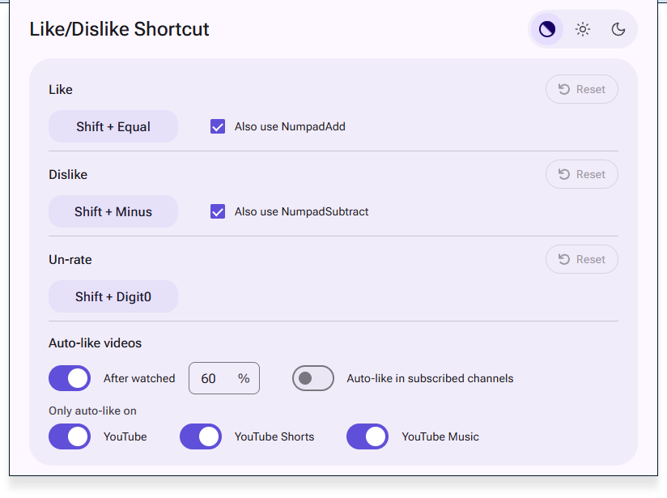

# YouTube Like-Dislike Shortcut

Works on both **YouTube** and **YouTube Music**

- Pressing the like/dislike shortcut while the corresponding button is already active will do nothing

Global keyboard shortcuts for YouTube Music (configurable in `chrome://extensions/shortcuts`, no defaults):

- Like, dislike, or unrate the playing YouTube Music song from any tab or window
- Only fires when there's a single YouTube Music tab and it isn't focused; when it is focused, the popup shortcuts above are used instead

Additionally:

- Auto-like by subscription also covers artists in your YouTube Music library
- The watched percentage is shown next to the like button while auto-like is active

**This extension does not reveal the videos' dislike counters**

Available for:

- [Google Chrome](https://chrome.google.com/webstore/detail/fdkpkpelkkdkjhpacficichkfifijipc) 120+ 
- [Mozilla Firefox](https://addons.mozilla.org/addon/youtube-like-dislike-shortcut)
  117+ 
- [Opera](https://addons.opera.com/en/extensions/details/youtube-like-dislike-shortcut) 106+ 

Made by [Avi](https://avi12.com)

## Claude Code

The repo includes `.mcp.json` with two MCP servers for browser automation:

- [chrome-devtools-mcp](https://npm.im/chrome-devtools-mcp) - connects to any Chromium-based browser via remote debugging on port 9225
- [firefox-devtools-mcp](https://npm.im/firefox-devtools-mcp) - connects to Firefox via Marionette on port 2828

## Requirements

Install [Node.js](https://nodejs.org), [Bun](https://bun.com) 1.4.5 and, for the dev server, [Rust](https://rustup.rs), then: `bun install`

## Dev

| Browser                | Command                            |
| ---------------------- | ---------------------------------- |
| Edge (default)         | `bun run dev`                      |
| Edge (with profile)    | `bun run dev:edge:with-profile`    |
| Chrome                 | `bun run dev:chrome`               |
| Chrome (with profile)  | `bun run dev:with-profile`         |
| Opera                  | `bun run dev:opera`                |
| Opera (with profile)   | `bun run dev:opera:with-profile`   |
| Firefox                | `bun run dev:firefox`              |
| Firefox (with profile) | `bun run dev:firefox:with-profile` |
| Edge, in Hebrew        | `bun run dev:rtl`                  |

The dev server builds the extension (production mode, into `build/<browser>-mv3-prod`), launches the
browser with it sideloaded and watches `src/`, `wxt.config.ts`, `package.json`, `bun.lock` and the env
files. Open tabs are never reloaded:

| What changed                                                     | What happens                                                  |
| ---------------------------------------------------------------- | ------------------------------------------------------------- |
| A Svelte component (markup, script or style), popup stylesheet   | Swapped in place                                              |
| Something only the popup loads, outside what can swap            | The open popup pages reload                                   |
| Anything else: content scripts of both worlds, background,       | The extension reloads, the running content scripts are undone |
| manifest, config, env, public files, added or removed entrypoint | and the new ones run in the open tabs and frames              |
| A build error                                                    | The browser keeps the last good build until the next save     |

Builds are written to `build/.staging` and then synced into the loaded directory, so it is never empty
or partial. Editor scratch files (`*.tmp.*`, `*~`, swap files) never start a build. A dev-only registry,
prepended to the built content scripts, records their listeners, observers and timers so they can be
undone; the `scripting` and `webNavigation` permissions are added to dev builds only. An extension
reload closes the extension's own pages, such as an open popup tab.

Chrome runs as Chrome for Testing (downloaded into `.chrome-for-testing/` on first use), since branded
Chrome no longer sideloads from the command line. Profiles live beside the repository, in
`../youtube-like-dislike-shortcut-profiles/`: a temporary one that starts empty on every run, or with
profile, a kept one seeded from your own browser's bookmarks (Firefox: session files). The remote
debugging port is 9225 (Firefox: Marionette on 2828); `bun run dev --help` lists the options.

The dev server is two Rust crates, adapted from
[youtube-downloader](https://github.com/avi12/youtube-downloader): [dev-server](dev-server) (file
watching, rebuild decisions and the debugging protocols) and [tools](tools) (the `devtool` binary: builds, HMR, browsers).
Test them with `bun run dev-server:test` and `bun run tools:test`.

## Build

| Browser | Command                 |
| ------- | ----------------------- |
| Chrome  | `bun run build`         |
| Opera   | `bun run build:opera`   |
| Firefox | `bun run build:firefox` |

## Package

Packaging builds first, so there is no separate build step to run.

| Browser | Command                   |
| ------- | ------------------------- |
| Chrome  | `bun run package`         |
| Opera   | `bun run package:opera`   |
| Firefox | `bun run package:firefox` |
| All     | `bun run package:all`     |

`bun run crx` packages Chrome and signs it into a `.crx` for GitHub releases. The signing key is created
in the gitignored `keys/` folder on the first run - keep it, since it fixes the extension ID

## Contribution

Feel free to contribute! Keep in mind that the license I chose
is [GPL v3](https://github.com/avi12/youtube-like-dislike-shortcut/blob/main/LICENSE)  
If you want to fork, make sure to credit [Avi](https://avi12.com) and link to this repository
